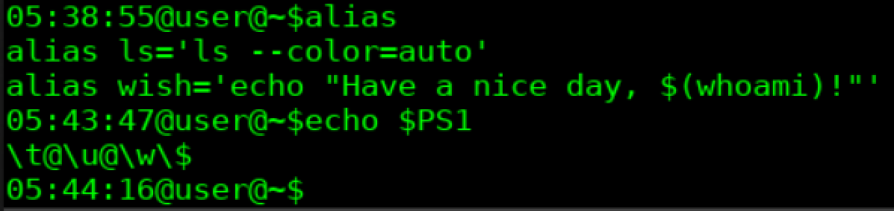
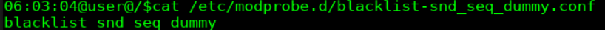
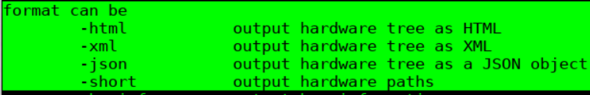

# Отчёт по практической работе 2 "Введение в Linux"

## Титульный лист

<div align="center">

# Национальный исследовательский университет ИТМО

## Факультет прикладной информатики

### Образовательная программа

### 45.03.04 «Интеллектуальные системы в гуманитарной сфере»

<br><br>

# ПРАКТИЧЕСКАЯ РАБОТА №2

## Расширение скриптов на BASH: работа с оборудованием и модулями ядра

</div>

<br><br>

**Дисциплина:** Введение в ОС Linux

**Выполнил:** студент группы К3161, Стяжкин Р. А.

**Преподаватель:** Корчагина Д. А.

**Дата:** 10.11.2026

<br><br><br>

<div align="center">

**Санкт-Петербург**  
**2026**

</div>

## Декларация использования ИИ

В процессе работы над проектом был использован ИИ в целях:

- Помощи разъяснения информации
- Помощи с примерами
- Помощи в самопроверке

## Артефакты

### Строка alias и содержимое $PS1 из Части 1.



### Все скрипты из Частей 2 и 3 (script221–script226, script23).

**script221.sh**

```BASH
#!/bin/bash

if [[ -z "$1" || -z "$2" || ! $# == 2 ]]; then
    echo 'Usage: script {str1} {str2}'
    exit 1
fi

if [[ "$1" = "$2" ]]; then
    echo "true"
else
    echo "false"
fi

```

**script222.sh**

```BASH
#!/bin/bash

FIRST=$1
SECOND=$2
THIRD=$3
INT_REGEX="^-?[0-9]+$"

if [[ ! "$FIRST" =~ $INT_REGEX || \
      ! "$SECOND" =~ $INT_REGEX || \
      ! "$THIRD" =~ $INT_REGEX || \
      ! $# == 3 \
]]; then
    echo 'Usage: script {int1} {int2} {int3}'
    exit 1
fi

if (( FIRST >= SECOND && FIRST >= THIRD )); then
    echo "$FIRST"
    exit 0
elif (( SECOND >= FIRST && SECOND >= THIRD )); then
    echo "$SECOND"
    exit 0
else
    echo "$THIRD"
    exit 0
fi

```

**script223.sh**

```BASH
#!/bin/bash

OUT=""

while read -r -p "Enter text or \'q\' to print and quit: "; do
    if [[ "$REPLY" == "q" ]]; then
        echo "$OUT"
        exit 0
    fi

    OUT="$OUT$REPLY"
done

```

**script224.sh**

```BASH
#!/bin/bash

COUNT=0

while read -p 'Enter even number to stop watching: ' INPUT; do
    if [[ ! $INPUT =~ ^-?[0-9]+$ ]]; then
        echo "Expected integer, got $INPUT"
        continue
    fi

    (( COUNT++ ))

    if (( INPUT % 2 == 0 )); then
        echo "$COUNT"
        exit 0
    fi
done

```

**script225.sh**

```BASH
#!/bin/bash

NANO=$(which nano)
VI=$(which vi)
LINKS=$(which links)

if [[ -z $NANO ]]; then
    echo "nano is not installed"
    exit 1
elif [[ -z $VI ]]; then
    echo "vi is not installed"
    exit 1
elif [[ -z $LINKS ]]; then
    echo "links is not installed"
    exit 1
else
    echo "1 - start nano"
    echo "2 - start vi"
    echo "3 - start links"
    echo "4 - quit menu"

    read INPUT

    if [[ ! "$INPUT" =~ ^[1-4]$ ]]; then
        echo "Invalid option: $INPUT. Available options: 1 2 3 4" >&2
        exit 1
    fi

    case "$INPUT" in
        1)
            nano
            ;;
        2)
            vi
            ;;
        3)
            links
            ;;
        4)
            exit 0
            ;;
    esac
fi

```

**script226.sh**

```BASH
#!/bin/bash

FILE_PATH="$1"
FLAG="$2"
LINES="$3"

if [[ ! "$#" == 3 || \
      ! "$FLAG" =~ ^[ht]$ || \
      ! "$LINES" =~ ^[0-9]+$ \
]]; then
    echo 'Usage: script {path} {h | t} {lines}' >&2
    exit 1
fi

if [[ ! -f "$FILE_PATH" ]]; then
    exit 1
fi

case "$FLAG" in
    "h")
        head -n "$LINES" "$FILE_PATH"
        exit 0
        ;;
    "t")
        tail -n "$LINES" "$FILE_PATH"
        exit 0
        ;;
esac

```

**script23.sh**

```BASH
#!/bin/bash

OUT=""

while read -r -p "Enter text or \'q\' to print and quit: "; do
    if [[ "$REPLY" == "q" ]]; then
        echo "$OUT"
        exit 0
    fi

    OUT="$OUT$REPLY"
done

```

### Доработанный скрипт инвентаризации и сгенерированный им отчёт из Части 4.

**script_passport_v2.sh**

```bash
#!/bin/bash

HOME_DIR="/home/user/lab2/PASSPORT_V2"

mkdir -p "$HOME_DIR" "$HOME_DIR/log" "$HOME_DIR/tmp"
cd "$HOME_DIR"

# .tmp file containing date and host
touch tmp/datehost.tmp

cat > tmp/datehost.tmp << QUIT
DATE: $(date)
HOST: $(hostname)
QUIT

# .tmp file containing user
touch tmp/user.tmp

cat > tmp/user.tmp << QUIT
CURRENT USER: $(whoami)

USERS:
$(who)
QUIT

# .tmp file containing working directory and all the files it includes

cat > tmp/files.tmp << QUIT
WORKING DIRECTORY: $(pwd)

FILES: $(ls -la)

HIERARCHY:

$(find .)
QUIT

# .tmp file containing system information

cat > tmp/system.tmp << QUIT
KERNEL: $(uname -s) $(uname -r) $(uname -n)
OS_VERSION: $(grep "VERSION=" /etc/os-release | cut -d'"' -f2)
CPU: $(grep "model name" /proc/cpuinfo | cut -d':' -f2 | xargs) $(grep "MHz" /proc/cpuinfo | cut -d':' -f2 | xargs)
LOGICAL_CORES_NUMBER: $(nproc)

L1d CACHE: $(lscpu | grep "L1d" | cut -d':' -f2 | xargs)
L1i CACHE: $(lscpu | grep "L1i" | cut -d':' -f2 | xargs)
L2  CACHE: $(lscpu | grep "L2"  | cut -d':' -f2 | xargs)
L3  CACHE: $(lscpu | grep "L3"  | cut -d':' -f2 | xargs)

TOTAL_PHYSICAL_MEMORY: $(lsmem | grep 'Total online memory' | cut -d':' -f2 | xargs)

MOTHERBOARD_NAME: $(cat /sys/class/dmi/id/board_name)

BIOS_VERSION: $(sudo cat /sys/class/dmi/id/bios_version)
BIOS_RELEASE_DATE: $(sudo cat /sys/class/dmi/id/bios_date)

===PCI DEVICES===

$(lspci)
QUIT

# passport.txt contains unified information from .tmp files
touch passport.txt

cat > passport.txt << QUIT
===DATE_AND_HOST===
$(cat tmp/datehost.tmp)

===USER_INFORMATION===
$(cat tmp/user.tmp)

===FILES_INFORMATION===

$(cat tmp/files.tmp)

===SYSTEM_INFO===
$(cat tmp/system.tmp)
QUIT

mkdir -p log

touch log/report.log

echo "Script was executed: $(date)" >> log/report.log

rm -r tmp

```

### Конфигурационный файл blacklist из Части 5.



## Вопросы и задания

1. Как определить, сколько параметров пользователь передал в скрипт при запуске?

Определить количество параметров можно с помощью переменной `$#`.

2. Какие недостатки есть у вашего подхода к определению производительности в FLOPS?

Примеры недостатков:

- Скрипт однопоточный, и не может использовать всю мощность ЦП;
- При каждом вызове `bc` в цикле создаётся новый процесс для вычисления, что тратит дополнительные ресурсы;

3. В нашем скрипте инвентаризации мы ради архитектурной чистоты не используем
   концепцию UNIX-way, которая ориентирована на разработку длинных конвейеров
   команд. Как можно в конвейере реализовать сразу сбор данных о CPU без
   промежуточных файлов? Напишите по одному аргументу за и против обоих подходов.

Получить все данные о CPU можно следующим пайплайном:

```bash
lscpu | awk -F: '
    /Model name/            {model=$2}
    /CPU MHz/               {mhz=$2}
    /CPU\(s\):/             {cores=$2}
    /L1d/ || /L1i/ || /L2/ || /L3/ {cache=cache ? cache", "$0 : $0}
    END {
        print "CPU & Freq:" model " @" mhz " MHz";
        print "Logical Cores:" cores;
        print "Caches:\n" cache
    }
' | sed 's/^[ \t]*//g'

```

Его плюс в том, что он потребляет куда меньше ресурсов, чем моя реализация, потому что lscpu вызывается один раз.

Его недостаток в том, что его гораздо сложнее читать и дебажить, чем реализация через временные файлы.

4. Утилиты modprobe и insmod нужны для загрузки модулей. В чём между ними разница?

Обе утилиты предназначены для загрузки модулей в ядро.

Разница между ними заключается в уровне абстракции. insmod является низкоуровневой утилитой, она требует предачи полного пути до модуля и ничего не знает о зависимостях. modprobe, в свою очередь, является умной надстройкой над insmod, которая позволяет оперировать короткими именами модулей и отслеживать их зависимости.

5. Предположим, вам необходимо, чтобы в системе использовалась аппаратная
   реализация алгоритма шифрования AES на CPU. Как определить, поддерживает ли
   процессор эту функцию?

Информация о поддерживаемых технологиях процессора зашита в его флагах. Их можно прочитать из файла `/proc/cpuinfo`

```bash
grep -q 'aes' && echo 'aes is supported' || echo 'aes not supported'
```

6. В Части 5 п.6 вы загрузили модуль драйвера. Откуда команда modprobe «узнала», где
   расположен файл этого модуля?

modprobe не сканирует диск сама. При сборке ядра и установке новых драйверов утилита depmod читает директорию `/lib/modules/$(uname -r)/`, проверяет зависимости внутри файлов `.ko` (kernel object) и формирует карту путей, из которой уже потом modprobe читает расположение модуля и его зависимости.

7. В каких форматах утилита lshw может генерировать отчёты? Для чего могут
   использоваться отчёты в каждом из форматов?

Поддерживаемые форматы:



- html: для загрузки на веб-страницу.
- xml и json: удобные форматы хранения данных, могут быть использованы хоть где.
- short: удобный для чтения формат, можно использовать прямо в оболочке.

8. Опишите значение полей в выводе команды lsmod.

- `Module`: короткое название модуля;
- `Size`: размер потребляемой ОЗУ в байтах;
- `Used by`: количество зависимостей и зависимые модули.
